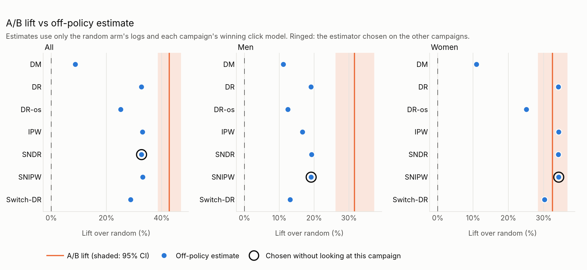
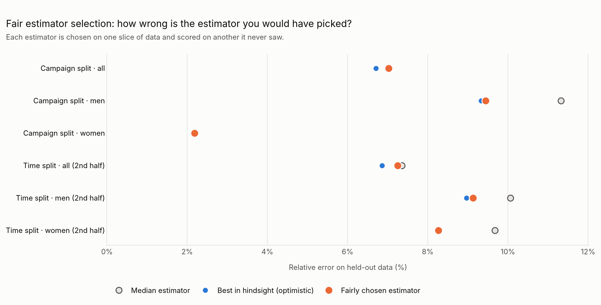

# Open Bandit A/B Testing

[](https://github.com/RollinsE/open-bandit-ab-testing/actions/workflows/tests.yml)
[](https://colab.research.google.com/github/RollinsE/open-bandit-ab-testing/blob/main/notebooks/00_run_pipeline_colab.ipynb)
[](LICENSE)

I wanted to know whether off-policy evaluation can pick a better recommender *before* it's shown to real users. The [Open Bandit Dataset](https://research.zozo.com/data.html) is a rare chance to check: ZOZOTOWN, a Japanese fashion site, ran a random recommender and a Thompson Sampling one side by side on about 27 million impressions, so the real answer is known.

So this project does two things with the same data:

- **A/B test**: compare the two recommenders' click-through rates (CTR) directly.
- **Off-policy evaluation (OPE)**: estimate Thompson Sampling's CTR using only the random recommender's logs, then check that estimate against its real CTR.

## What I found

- **Thompson Sampling clearly won**, lifting click-through by 32–43% across the three campaigns.
- **Off-policy evaluation picked the right winner every time** (21 out of 21 estimates), using only the random recommender's logs. But it undersold the size of the win for two campaigns: about +33% and +19% for "all" and "men", against a measured +43% and +32%. For "women" it was spot on (+34% vs +32.5%). So it's good enough to tell you *which* algorithm to ship, but I wouldn't use it to promise *how much* better it'll be.
- **The simple estimators did as well as the clever ones.** Clicks are so rare that the best click model only beat a constant guess by about 1%, so the doubly robust estimators had little extra to work with. The direct method relies entirely on that model, and it was the worst every time.
- **Choosing the estimator honestly cost almost nothing.** Picking it on data it hadn't seen gave errors within half a percentage point of the best choice in hindsight.

## Results

Full dataset, default settings:

| Campaign | A/B lift (95% CI) | Lowest OPE error | Campaign-split error | Time-split error |
|---|---|---|---|---|
| All | +42.8% (+38.6% to +47.0%) | 6.7% | 7.0% | 7.3% |
| Men | +31.6% (+26.1% to +37.3%) | 9.3% | 9.4% | 9.1% |
| Women | +32.5% (+28.4% to +36.7%) | 2.2% | 2.2% | 8.3% |

OPE error is the relative error of the estimated CTR against Thompson Sampling's real CTR. The split errors are for an estimator chosen without access to the data it is scored on: on the other two campaigns (campaign split), or on the first half of the week and scored on the second (time split). All A/B results are significant at p < 0.001, and every off-policy estimate identified the correct winner.

<picture>
  <source media="(prefers-color-scheme: dark)" srcset="docs/images/ab_vs_ope_lift-dark.png">
  
</picture>

*Lift of Thompson Sampling over the random recommender: the A/B test result (orange line, shaded 95% interval) against each estimator's prediction made from the random recommender's logs alone. Ringed: the estimator chosen without seeing that campaign.*

<picture>
  <source media="(prefers-color-scheme: dark)" srcset="docs/images/estimator_selection-dark.png">
  
</picture>

*Error of the estimator chosen on separate data (orange), next to the best estimator in hindsight (blue) and the median estimator (grey).*

The full report with all interactive figures is written to `reports/report.html` in each build.

## Pipeline

| Stage | Description | Main outputs |
|---|---|---|
| 1. Data loading and validation | Loads both arms for each campaign (all, men, women) and validates clicks, propensities, slots and item IDs | `dataset_summary.csv` |
| 2. A/B test | CTR per arm, lift with confidence intervals, z-test and Fisher's exact test, power analysis | `ab_test_results.csv`, `ab_test_power.csv` |
| 3. Reward model marathon | Click models compete under cross-validation; the simplest model within a margin of the best wins | `model_performance.csv`, `reward_model_winners.json` |
| 4. Off-policy evaluation | Seven estimators (DM, IPW, SNIPW, DR, SNDR, Switch-DR, DR-os) benchmarked against the true CTR, with fair estimator selection | `ope_summary.csv`, `estimator_selection.csv` |
| 5. A/B vs OPE comparison | Converts each estimate into a lift and compares it with the A/B result | `ab_vs_ope_comparison.csv` |
| 6. Reporting | Interactive Plotly figures and a written report | `report.html`, `report.md` |

See [docs/methodology.md](docs/methodology.md) for details of each stage.

## Getting started

### Google Colab

1. Open the notebook with the **Open in Colab** badge above.
2. Run the cells in order. By default the pipeline runs on the bundled sample.
3. To use the full dataset, download `open_bandit_dataset.zip` from the [dataset page](https://research.zozo.com/data.html), upload it to Google Drive, and in the settings cell set `USE_DRIVE = True` and `DATA_ZIP` to its path.

If the session disconnects, re-run the cells: the run resumes where it stopped.

### Local installation

Requires Python 3.10 or later.

```bash
git clone https://github.com/RollinsE/open-bandit-ab-testing.git
cd open-bandit-ab-testing
pip install -r requirements/colab.txt
```

## Usage

Run on the bundled sample:

```bash
python cli.py --promote-release
```

Run on the full dataset (unzipped so that the folders read `<dir>/random/all/all.csv` and so on):

```bash
python cli.py --data-dir /path/to/open_bandit_dataset --continue-build auto --promote-release
```

`--continue-build auto` resumes an interrupted run, or starts a new one if there is nothing to resume, so the same command can be repeated after any interruption.

Rebuild only the report from a finished build, without repeating any computation (it reads the same data folder the build used):

```bash
python cli.py --only-stage 6 --resume-build outputs/builds/<run_id> --promote-release
```

Common `make` targets:

```bash
make install      # install dependencies
make run          # run (resumes if interrupted), promoted to outputs/releases/latest
                  # add DATA_DIR=/path/to/open_bandit_dataset for the full dataset
make run-quick    # quick check of the setup
make continue     # resume an interrupted run
make test         # run the test suite
```

**Runtime.** The bundled sample runs in a few minutes. The full dataset takes about 1.5 hours on a standard Colab runtime (2 CPU cores); `--no-time-split` shortens this by about 40 minutes. Progress, with estimated time remaining, is written to the log.

### Options

| Option | Default | Description |
|---|---|---|
| `--mode` | auto-detected | `colab`, `production` or `local` |
| `--data-dir` | bundled sample | Folder containing the full dataset (or set `OBD_DATA_DIR`) |
| `--output-dir` | `outputs` | Root folder for builds and releases |
| `--campaigns` | `all men women` | Campaigns to analyse |
| `--n-runs` | `10` | Bootstrap repetitions in the OPE benchmark |
| `--n-sim` | `1000000` | Monte Carlo draws for Thompson Sampling's action probabilities |
| `--model-families` | all installed except `gradient_boosting` | Model families in the marathon |
| `--model-trials` | `8` | Tuning trials per tuned family (`0` = no tuning) |
| `--tune-top` | `2` | Number of families tuned after the first round (`-1` = all) |
| `--winner-rule` | `simplest` | `simplest`: simplest model within the margin of the best; `best`: lowest log loss |
| `--winner-tolerance` | `0.0025` | Practical-equivalence margin for `simplest`, as a fraction of the best log loss |
| `--no-ensemble` | off | Exclude the ensemble from the marathon |
| `--marathon-max-rows` | `200000` | Stratified row sample for the marathon (`0` = all rows) |
| `--tune-max-rows` | `50000` | Rows used for each tuning search (`0` = all training rows) |
| `--ope-fit-max-rows` | `200000` | Click-model training rows per fold in the OPE benchmark (`0` = all rows) |
| `--no-time-split` | off | Skip the time-split estimator selection |
| `--alpha` | `0.05` | Significance level for the A/B test |
| `--expected-control-share` | off | Intended control share; enables the sample ratio check |
| `--continue-build` | off | Resume a build: `auto`, `latest` or a build folder |
| `--from-stage`, `--to-stage`, `--only-stage` | `1` to `6` | Run part of the pipeline |
| `--resume-build` | off | Reuse an earlier build's outputs for skipped stages |
| `--promote-release` | off | Copy a successful build to `releases/<name>` |
| `--release-name` | `latest` | Name of the release folder |
| `--random-state` | `12345` | Random seed |
| `--n-jobs` | `-1` | Parallel jobs (capped by available memory) |
| `--log-level` | `INFO` | `DEBUG`, `INFO`, `WARNING` or `ERROR` |
| `--heartbeat-minutes` | `3` | Interval for "still running" log lines during long steps |
| `--show-plots` | off | Display figures inline in a notebook |

`python cli.py --help` describes every option.

## Outputs

Each run writes to its own build folder:

```
outputs/
  builds/<run_id>/
    run_manifest.json    settings, data folder, stage plan and status
    logs/                full run log
    checkpoints/         finished work, used to resume interrupted runs
    artifacts/           result tables (CSV, JSON)
    reports/
      report.html        report with interactive figures
      report.md          report in Markdown
      figures/           each figure as HTML (and PNG when Kaleido is installed)
  releases/latest/       copy of the most recent promoted build
```

To export a build's figures as PNG images, in light and dark versions (as used in this README):

```bash
python scripts/export_figures.py outputs/releases/latest docs/images
```

## Project structure

```
cli.py                      command-line entry point
pipeline.py                 stage orchestration, build folders, run manifest
src/
  config.py                 runtime detection, data paths, output layout
  constants.py              settings and model hyperparameters
  utils.py                  logging and progress reporting
  data_pipeline.py          stage 1: data loading and validation
  ab_testing.py             stage 2: A/B test statistics
  model_evaluation.py       stage 3: candidate models, tuning, scoring, winner rule
  model_training.py         stage 3: marathon per campaign
  off_policy_evaluation.py  stage 4: OPE benchmark
  estimator_selection.py    stage 4: fair estimator selection
  comparison.py             stage 5: A/B vs OPE comparison
  visualization.py          Plotly figures
  reporting.py              stage 6: report
  checkpoints.py            checkpoint store and build lock
  stage_resume.py           partial runs and --resume-build
  release_manager.py        builds and releases
  obp_lite/                 dataset loader, policies, reward model, estimators
data/obd/                   bundled dataset sample
docs/                       methodology and README images
notebooks/                  Colab notebooks
scripts/                    utility scripts (figure export)
tests/                      pytest suite
requirements/               dependency files
```

## Testing

```bash
pip install -r requirements/dev.txt
pytest tests/
```

The suite covers the A/B statistics, the estimators, the model marathon and winner rule, fair estimator selection, the large-data code paths, checkpointing and resuming, logging, and complete pipeline runs on the bundled sample. It runs on every push via GitHub Actions.

## Citation

The Open Bandit Dataset and the original Open Bandit Pipeline are by ZOZO Research. If you use the dataset, please cite:

> Yuta Saito, Shunsuke Aihara, Megumi Matsutani and Yusuke Narita. *Open Bandit Dataset and Pipeline: Towards Realistic and Reproducible Off-Policy Evaluation.* NeurIPS 2021 Datasets and Benchmarks Track. [arXiv:2008.07146](https://arxiv.org/abs/2008.07146)

## License

MIT. See [LICENSE](LICENSE). `src/obp_lite/` is derived from Apache-2.0 licensed code; see [NOTICE](NOTICE) and the licence in that folder.
